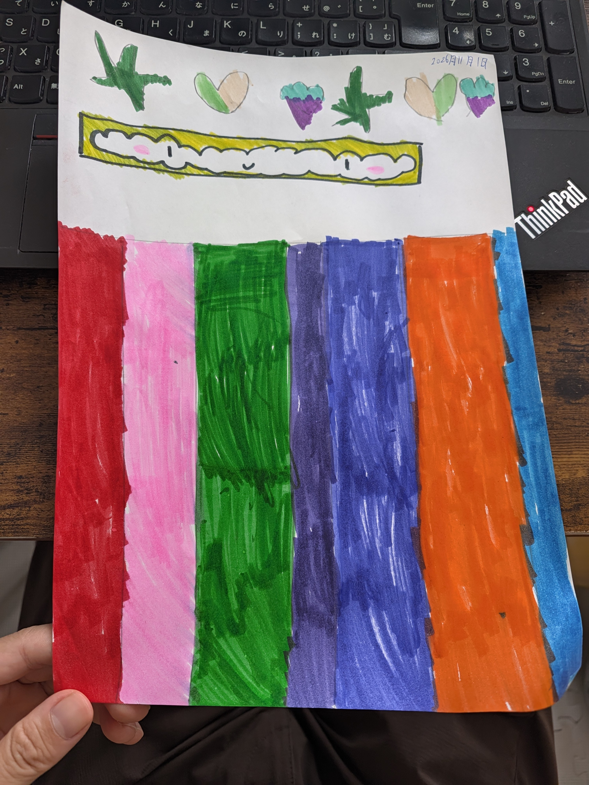

# 🌈 彩虹糖下雨 (Rainbow Candy Rain)

<p align="center">
  
</p>

<p align="center">
  <a href="LICENSE"></a>
  
  
  <a href="CONTRIBUTING.md"></a>
</p>

<p align="center">
  <b>“这是我女儿用手画的，设计的一个游戏……”</b><br>
  一款根据小画师于 <b>2026年11月1日</b> 亲笔手绘图纸原汁原味还原的网页益智街机小游戏。
</p>

---

## 🌟 在线畅玩 (Online Play)

> 本项目为纯静态单文件网页游戏，支持直接通过 **GitHub Pages** 一键在线畅玩：

* 🚀 **在线入口**：`https://<你的GitHub用户名>.github.io/<仓库名>/` (开启 GitHub Pages 后即可访问)
* 📱 **跨端即开即玩**：无需安装 App，桌面端（Windows / macOS / Linux）与移动端（iPad、iPhone、Android 手机）均可完美自适应运行。

---

## 🎨 手稿细节致敬与还原

游戏像素级致敬还原了小画师原作的所有纯真细节：
1. **顶部 6 个手绘小标志**：绿十字星、绿桃双色爱心（包含原画第 2 颗爱心颜色左右对调的趣味细节）、蓝顶紫莓心，以及右上角的手写签名日期 `2026年11月1日`。
2. **微笑云朵横条**：黄绿色马克笔粗边框、波浪纹白云、粉扑扑的腮红脸蛋与可爱笑脸。滑行时眼睛会跟随机灵转动，接对糖果还会欢呼变成 `^ ◡ ^`！
3. **严格还原的 7 彩条跑道**：按手稿从左到右严格的排列次序与宽窄配比（**草莓红、蜜桃粉、苹果绿、葡萄紫、蓝莓蓝、甜橙橘、苏打天蓝**），配备手绘涂色质感与 `Do-Re-Mi-Fa-Sol-La-Ti` 七音阶互动反馈。
4. **内置画作对比**：点击游戏右上角 `🎨 原作` 按钮，随时可调出手绘稿高清对比。

---

## 🎮 游戏体验

仓库提供游戏大厅 `index.html` 以及彩虹糖下雨游戏 `rainbow_candy_rain/index.html`：

| 体验文件 | 名称 | 核心机制 | 适合人群 |
| :--- | :--- | :--- | :--- |
| **[index.html](index.html)** | **游戏大厅入口** | 精美卡片大厅导航，汇聚游戏入口并支持未来新游戏扩展 | 默认主页入口 |
| **[rainbow_candy_rain/index.html](rainbow_candy_rain/index.html)** | **彩虹糖下雨（奇幻魔法版）** | 云朵嘴边挂着饱满彩色糖果，穿过 **×2/×3 倍增泡泡**、激活顶部 **6 大手绘魔法图标**（流星雨/彩虹磁铁/紫莓甘霖）、触发 **连击彩虹暴走喷泉**，拍飞坏炸弹与贪吃虫，收集 **8 枚贴纸徽章**，**7 个管子各装满 10 颗即可三星通关**！支持奇幻标准、刺激挑战、轻松宝宝 3 种模式。 | 全年龄段、亲子互动 |

---

## 🕹️ 全平台操控指南 (Controls)

### 💻 电脑端 (键盘 & 鼠标)
* **左右移动**：键盘方向键 `←` / `→`，或 `A` / `D` 键；亦可用鼠标按住云朵自由拖拽。
* **快速选列**：按数字键 `1` ～ `7`，云朵瞬间滑行至第 1～7 列颜色跑道。
* **主要动作键 (空格键 / Enter / ↓)**：立即放下当前挂在嘴边的糖果。

### 📱 iPad / 手机端 (触控优化)
* **直接触摸拖动**：单指在屏幕任意位置按住左右滑动，云朵如影随形。
* **点击颜色跑道**：直接轻点下方任意一条颜色列，云朵自动滑移对齐。
* **屏幕底部大按钮**：
  * `⬅️ 左移` / `右移 ➡️`：按住平滑移动。
  * `💥 中间操作按键`：轻触立即放下糖果。

---

## 📂 项目结构 (Project Structure)

```text
├── index.html                   # 游戏大厅入口 (Game Hub)
├── rainbow_candy_rain/          # 彩虹糖下雨 游戏目录 (Rainbow Candy Rain)
│   ├── index.html               # 游戏页面
│   ├── style.css                # 游戏样式表
│   └── game.js                  # 游戏主逻辑与音效合成引擎
├── artwork.jpg                  # 女儿于 2026-11-01 创作的手绘原作 (已完全脱敏 EXIF)
├── README.md           # 项目完整文档
├── LICENSE             # MIT 开源许可证 & 艺术版权声明
├── CONTRIBUTING.md      # 开源贡献指南
├── SECURITY.md         # 安全策略与漏洞通报指引
└── .gitignore          # Git 忽略配置
```

---

## 🛠️ 技术亮点

* **纯原生、零外部依赖 (Zero Dependency)**：不依赖任何 npm 包、React/Vue 框架或大型第三方游戏引擎，单个 HTML 文件直接双击即可运行。
* **自适应响应式布局**：基于现代 Viewport 单位与动态 Canvas 重绘，原生支持电脑横屏、iPad 平板与各类手机的视网膜屏（Retina Display）。
* **内置 Web Audio 动态合成器**：无需加载任何外部音频 MP3 文件，利用浏览器的原生 Web Audio API 动态合成八音盒童趣音阶与爆炸音效。
* **隐私安全规范 (Privacy-First)**：素材图片已彻底剥离设备序列号、GPS 位置与 C2PA 数字指纹，无任何追踪脚本或外部埋点。

---

## 🚀 本地开发与体验

```bash
# 启动本地简单服务器
python -m http.server 8080

# 访问测试
# 电脑端：http://localhost:8080
# 手机/iPad：http://<你电脑的局域网IP>:8080
```

---

## 📄 开源许可证 (License)

* **代码部分 (Code)**：遵循 [MIT License](LICENSE)。
* **手绘美术素材 (Artwork)**：手绘图稿 `artwork.jpg` 归小画师所有，遵循 [CC BY 4.0](https://creativecommons.org/licenses/by/4.0/) 许可，允许非商业自由分享与衍生创作。
